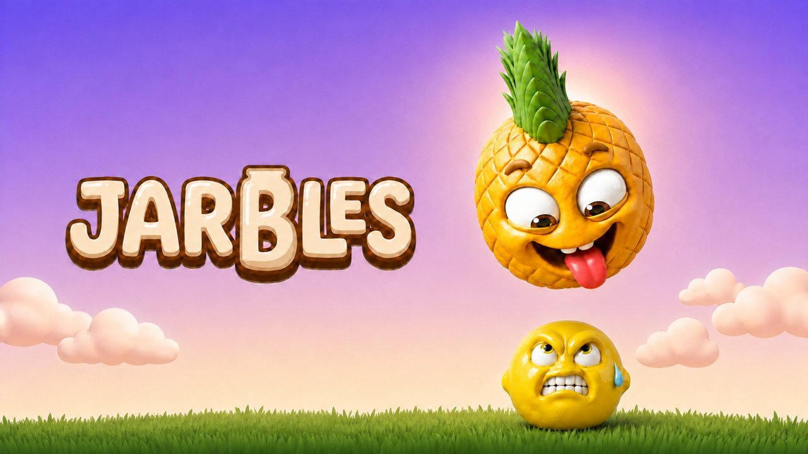
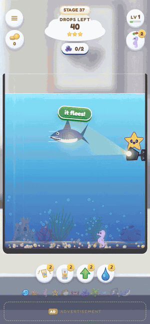
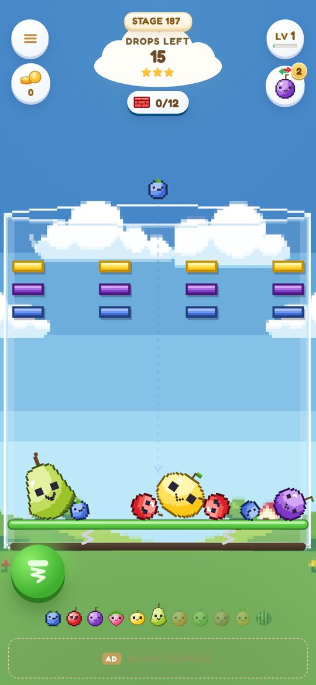
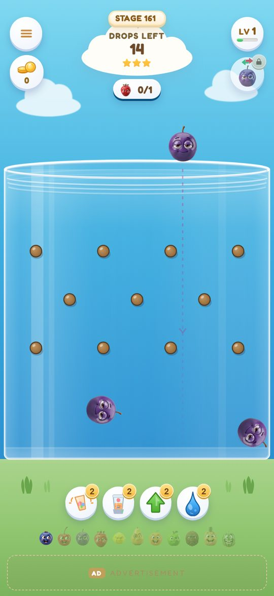
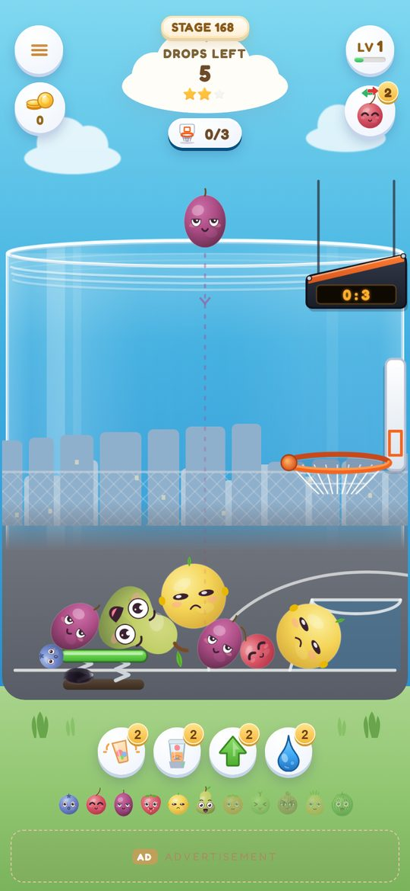
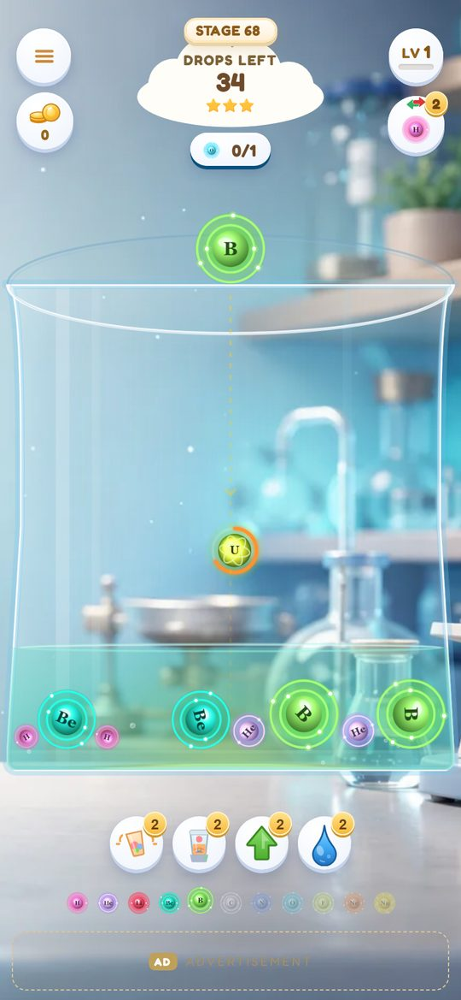
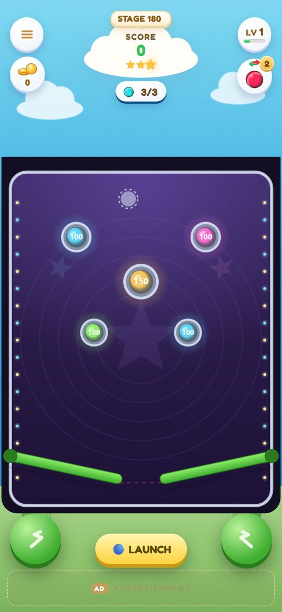
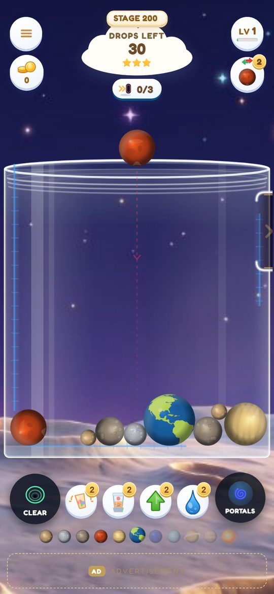
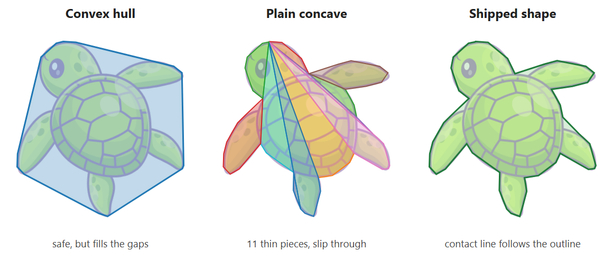
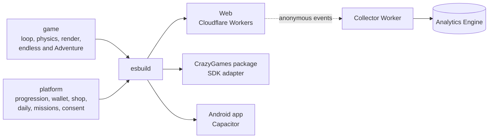

# Jarbles

A physics merge game for phones, written from scratch in plain JavaScript on Canvas 2D, with Matter.js for the physics. It plays in the browser, and the same codebase is also packaged for the CrazyGames portal and as an Android app.

Solo project, 2026: game code, build, tests and packaging.

**[Play it in your browser](https://jelly-town.offart.workers.dev/home-static/)**, best on a phone.

**Highlights**

- Measured a freeze when a win opened a gate on the level map, traced it to a 960 KB rebuild of HTML, and cut it from 833-900 ms to 367-433 ms under 6x CPU throttling.
- Made sea creatures collide by their real outline on a physics engine that only handles convex shapes, with nothing passing the jar wall in the test.
- Added a regression check on the Canvas drawing commands of every Adventure stage, next to the checks on the game state.

  

## The game

Drop fruit into a jar and merge two of a kind into the next size up. Next to the endless mode there is an Adventure campaign of 201 stages in 37 areas, and many areas bring a new mechanic into the same jar, such as pachinko pegs, a basketball hoop, pinball flippers, a uranium reactor, a breakout wall, Space Invaders and portals with gravity.

<table>
  <tr>
    <td align="center"> Pixel Town</td>
    <td align="center"> Pachinko Pegs</td>
    <td align="center"> Basketball</td>
  </tr>
  <tr>
    <td align="center"> The Reactor</td>
    <td align="center"> Pinball</td>
    <td align="center"> The Wormhole</td>
  </tr>
</table>

Around the game sit progression, achievements, daily missions, a daily challenge, a collection album and a shop in virtual currency. Saves live on the device, with a migration step between save versions.

## Engineering notes

### The level map after a win

When a win opened a gate on the level map, the screen froze while the map updated. I traced it to the map rebuilding all 200 tiles, about 960 KB of HTML, in one synchronous pass, and changed it so only the rows whose state changed are rebuilt.

Frozen time from the tap on the win card, measured on the real home screen at 390x844:

| CPU throttling | Before | After |
|---|---|---|
| 6x slower | 833-900 ms | 367-433 ms |
| 4x slower | 583-667 ms | 217-233 ms |

### Concave creatures on a convex-only physics engine

The Shark Reef stages fill the jar with sea creatures that should touch by their real outline. Matter.js collides only convex shapes, so it splits a concave body into thin pieces, and under the weight of a pile a flipper or a tail slips through the wall. In a heavy pile the hugging outline left the turtle 25 px outside the jar. Its convex hull stayed inside, but filled the gaps between the flippers, so nothing could sit close to it.

The shipped shape keeps the drawn outline as the contact line and keeps every creature inside the jar. A headless test on the real engine checks that the outline keeps its pockets, 30 px deep on the turtle, that nothing passes the wall under a squeeze from both sides, and that all 15 creature pairs collide with at most 0.23 px of overlap.

### Physics that differs between devices

I ran the same seeded game on desktop Chrome and on a physical Android phone, and Matter.js diverged after about 900 simulation steps. So the daily challenge does not depend on identical physics. Every player gets the same fruit sequence from a seeded generator built on integer math, which is identical on every device.

### Checking the picture, not only the state

A golden master replays a fixed drop script on every Adventure stage and compares the simulation. A second gate records the Canvas 2D drawing commands of one frame per stage and compares them with a committed trace, so a drawing change shows up even when the game state stays the same.

## How it is checked

Every push and pull request runs two GitHub Actions jobs.

- **Fast checks**, with nothing to install. 878 unit tests for the platform layer and 24 for the analytics worker on `node:test`, an RNG state round-trip, daily challenge checks, and economy simulations that run twice and must come out byte-identical.
- **Headless browser**, Playwright with Chromium. The build, golden masters for the endless mode and for every Adventure stage, the drawing gate, a resume round-trip and a cost gate on opening a level.

Both jobs passed on main on 6 October 2026.

## Architecture

Gameplay events leave the device with an anonymous install id and no personal details. Players in the EEA, the UK and Switzerland are asked before anything is collected.

## Stack

JavaScript without a framework, Canvas 2D, Matter.js, Web Audio, esbuild, Capacitor, Cloudflare Workers, GitHub Actions, Playwright.

## Source code

The code lives in a private repository. A private code review is available to hiring teams by arrangement.

Meir Mizrahi, [offart.space](https://offart.space), meir@offart.space
